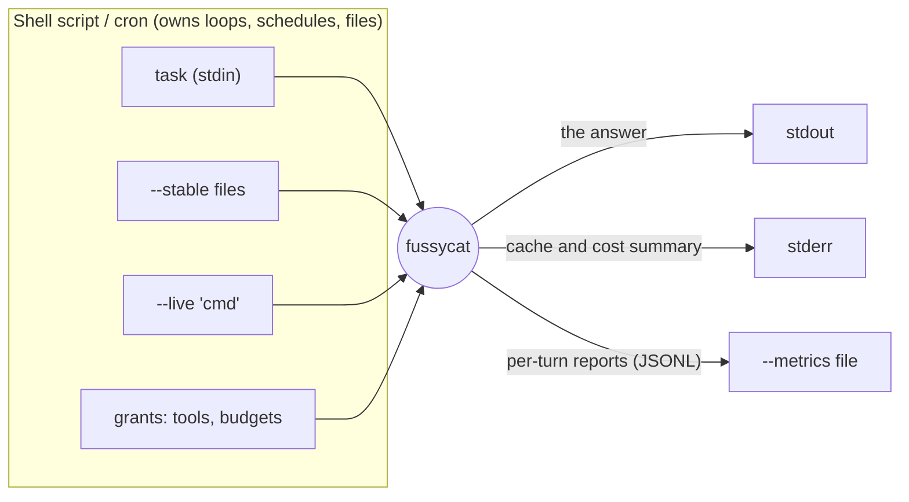

# INTENT

> A **fussy cut** is a quilt piece cut so one motif sits exactly where you want
> it, the way each block of an agent's context frames one thing for the model.
> The tool is *fussycat*; the pattern it implements is the *Agent Quilt*.

This file says **why** fussycat exists and **what** it is, never how. It's the
tie-breaker for every other doc: the domain language is in
[`domain-design.spec.md`](domain-design.spec.md), and the checks that keep the
code honest to this file are in [`architecture.eval.md`](architecture.eval.md).

## Why

Most agents learn about the world through tool calls. That's chatty, slow and
token-expensive, and stale results pile up in the conversation. The
[Agent Quilt pattern][pattern] builds the context window from **blocks** with
known lifetimes instead, so the harness can lay them out for prompt-cache
reuse and refresh state *without* the agent having to ask.

The bet:

- **Faster and cheaper:** live state goes in a block instead of a tool
  round-trip, and the stable prefix stays cached, across turns and runs.
- **Better answers:** less context rot, because state is replaced, never
  accumulated.
- **Tunable per agent:** you choose exactly which blocks an agent gets.

It's also fun to build. That counts.

## What

**A single-binary, unix-philosophy agent CLI that implements the
[Agent Quilt Framework][spec].** You declare an agent's blocks and grants on
the command line, pipe a task in, and get the answer on stdout. It composes
with `cron`, `tee`, `jq`, `>>` and shell scripts like any other small tool.
Illustrative, not an API:

```sh
fussycat \
  --model venice:claude-haiku-5-5 \
  --stable brief.md \
  --live 'date -u' \
  --live 'curl -s https://status.example/api' \
  --tool tools/*.toml \
  --tool 'disk=df -h' \
  --max-cost 0.05 \
  < task.txt >> digests/$(date +%F).md
```



## Principles

The tie-breakers: when a design question comes up, these decide it.

1. **Unix philosophy.** Do one thing well and compose. Loops, schedules,
   persistence and output files belong to the shell *around* fussycat, not
   inside it. "Is it unixy?" is a real design criterion.
2. **Least surprise, deny by default.** A bare run has no tools. Every tool,
   write capability and budget is granted explicitly, so **the command line
   is the permission manifest**. Ambient settings may set defaults and limits
   but **never grant capabilities**. No network calls except the ones the run
   needs: no telemetry, no update checks. The same rule runs outwards:
   **fussycat doesn't sandbox; it's built to be sandboxed**, and passes no
   secrets to the tools it runs unless one is named.
3. **Cache-efficient by construction.** The author declares block kinds;
   fussycat owns the layout. Layout is a **pure function of the
   declarations**: it never reorders on what it observes at runtime, and
   never injects volatile content of its own above the log. The same
   declarations give the same bytes, so separate processes (a shell loop, a
   daily cron) share the provider's cache.
4. **Observable.** Cache and cost behaviour are first-class output, not a
   debug afterthought. Numbers come from what the provider reported, never
   estimates, so they can drive optimisation. fussycat reports problems; it
   doesn't hide them with magic.
5. **Interface-agnostic core.** The CLI is one adapter over a core that knows
   nothing about argv or stdio, so the core is testable without either.
6. **Provider-agnostic, without hiding caching.** The same agent runs on any
   supported provider. The provider layer exposes cache control and cache
   stats; it doesn't abstract them away.
7. **Make it work, make it right, make it fast.** In that order. *Right*
   means the invariants (layout, deny by default): cheap to hold from day one
   and expensive to retrofit, so the evals guard them from the start. *Fast*
   means tuning cache, cost and latency once there's something real to
   measure.

## The scenario it's for

> A script run daily from cron calls fussycat with a brief as a stable block,
> `date -u` as a live block, and web search and page fetch granted as tools,
> on a cloud or a local model. It writes a digest to stdout
> (`>> digests/$(date +%F).md`), a one-line cache and cost summary to stderr,
> and a report per turn to `--metrics`.
>
> **Done** = it runs every day without babysitting, *and* the metrics show the
> stable prefix being served from the cache.

## Scope

**In:** stdin is the task and stdout the answer; `--stable` and `--live`
blocks; tools granted on the command line (shell commands, and TOML tool
files with typed inputs); budgets that guarantee a run ends; providers that
report cache use (Anthropic, Venice, Ollama); metrics on stderr and as JSONL.
Every run starts fresh: nothing survives the process except what the shell
keeps.

**Later**, when something real needs it:

- **Pinned blocks**, with the agent walking a document index and pinning what
  it needs.
- **Forks:** a grantable tool whose child reuses the parent's prefix and
  returns one result.
- **MCP servers** as grantable tool sources.
- **Batteries:** built-in tools, off until granted, needing nothing outside
  fussycat and the OS (`read_file`).
- **Settings files** for defaults and limits (never grants, principle 2).
- **Compaction**, once single runs get long enough to need it.
- Structured output (`--format jsonl`), images and other modalities.

**Parked:** an agent definition file (maybe with a `#!/usr/bin/env fussycat`
shebang); opt-in sessions that persist the log across runs.

## Non-goals

- Personas, role-play committees, agent-to-agent chat protocols.
- Being an orchestrator: no built-in loops, schedulers or job queues. That's
  the shell's job.
- A resident agent or server mode. A long-lived agent is a loop in the shell
  (cron, systemd, `while`) around short runs.
- A prompt templating language.
- An interactive chat or TUI coding agent. Others do that well.

[pattern]: ../docs/agent-quilt.md
[spec]: ../docs/agent-quilt-framework.md
