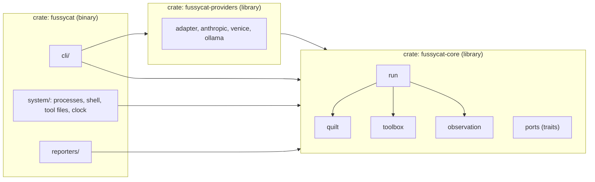

# Architecture evals

> The checks that keep fussycat focused. Run them before committing, and
> state the result in the pull request. Why and what: [`INTENT.md`](INTENT.md).
> Language and model: [`domain-design.spec.md`](domain-design.spec.md).

Each check names the principle (P1–P7 in INTENT) or decision (D1–D6, and the
framework's L and A rules) it protects. A check that can't be made to pass is
a design conversation, not something to quietly delete.

## Shape

The checks assume this layout. Changing it is an architecture decision, so
update this section first.



- **`fussycat-core`**: the domain and its ports. It does no I/O, has no async
  runtime and knows no provider. It's a separate crate so the compiler, not
  discipline, keeps dependencies pointing inward (P5).
- **`fussycat-providers`**: the provider adapters, the reusable half of
  fussycat besides the core, so another host (a server, a game loop) can
  use them without copying. A library for any host: no CLI, no printing, no
  processes. It takes an API key as a value; how the key is fetched is the
  host's business.
- **`fussycat`**: the CLI and the other adapters: processes, the shell,
  tool files, reporters. It runs the key command and passes the key on.
- **Provider layer: [`rig-core`][rig]**, pinned to an exact version, used
  only inside `fussycat-providers`. We use its *model layer* (requests, cache
  points, usage, thinking round-trips) so we don't have to keep pace with
  every LLM ourselves. We never use `rig-agent`: the loop and the quilt are
  fussycat's job. Rig ships breaking minors often, so it stays behind the
  `Provider` port (S8), upgrades are deliberate, and golden request bytes
  catch silent changes. Plan B, if rig stops fitting: `genai`, behind the
  same port.

[rig]: https://github.com/0xPlaygrounds/rig

## How to run

```sh
cargo fmt --check && cargo clippy --workspace --all-targets -- -D warnings
cargo test --workspace               # includes the behavioural evals
cargo test --workspace arch_         # only the behavioural evals
scripts/arch-eval.sh                 # structural checks S1–S11, silent on pass
cargo test --workspace -- --ignored   # PAID provider tests: run on purpose, never in CI
for s in ask shell-tools context-blocks tool-files limits-and-exit-codes \
  metrics isolation providers; do examples/$s.sh >/dev/null || echo "FAIL $s"; done
```

CI runs all but the paid tests and the [examples](../examples/README.md) on
every pull request, plus gitleaks over the whole history. Anything that
needs a live model stays a local check: a model's answers would make CI
flaky. The examples need Ollama, and skip their paid parts without a key
command.

Then the review questions (R1–R7).

## Structural (mechanical)

| # | Rule | Protects |
|---|---|---|
| S1 | Core's dependencies come from an allowlist (in the command). Adding one means editing it here, on purpose. | P5 |
| S2 | Core never touches the world: no env, fs, net, process, stdio, printing or wall clock (use the `Clock` port). | P5, testability |
| S3 | Provider specifics stay in the adapters (`fussycat-providers`): the core names no provider. | A2, P6 |
| S4 | HTTP clients appear only in `fussycat-providers`: no update checks, no telemetry. | P2 |
| S5 | Printing happens only in the CLI and reporters, never in `fussycat-providers`. Stdout is the answer and nothing else. | P1, P4 |
| S6 | No crate, package or binary named *quilt* (that name is the Debian tool's). | AGENTS.md |
| S7 | No source file over 600 lines. | AGENTS.md |
| S8 | The LLM library (`rig_core`) is used only in `fussycat-providers`, and `rig-agent` not at all. That crate is a library for any host: no `clap`. | A2, P6, churn containment |
| S9 | Only `system/shell.rs` starts a shell, and only with the author's command text. Tool files run an argv list directly. | P2 |
| S10 | Every child process is built in `system/process.rs`; `fussycat-providers` starts none, not even in its tests. Every child the model can set off (tools, live commands) is built by `isolated`, so none escapes the clean environment; only the key command, the author's and run before the model is called, gets fussycat's own (`inheriting`). | P2, Security model |
| S11 | Nothing tracked names a private network: its hosts, its people's home paths. The names are private too, so they live outside the repo, one regex per line, in the file `FUSSYCAT_PRIVATE_NAMES` names; without it, S11 is skipped. | Open source |

[`scripts/arch-eval.sh`](../scripts/arch-eval.sh) holds the commands, one
function per rule; S1's allowlist lives there. It prints only
violations and exits non-zero on any. The greps are approximate (a
`use std::{fs, env}` slips past S2); review catches what they miss.

## Behavioural (`cargo test arch_`)

Tests in code, named `arch_*` so they run as a group. They use fake ports,
so there's no network and no shell. Each one guards an invariant that
would otherwise fail silently, as a cache miss, an extra grant or a run that
never ends.

A check is **pending** until the feature it guards exists; the PR that adds
the feature adds the test. A PR body lists pending checks as pending, never
as passing.

| # | Test | Asserts | Protects |
|---|---|---|---|
| B1 | `arch_layout_groups_by_kind` *(pinned joins it when pinned blocks exist)* | Declarations given in mixed kind order lay out as stable, pinned, log, live, keeping declaration order within each kind. The same Agent always gives the same layout. | L1, D2, P3 |
| B2 | `arch_render_is_deterministic` | Rendering the same blocks twice gives byte-identical requests. Tools are sorted by name whatever order the grants came in. Each provider adapter also pins its wire bytes to a golden file (`crates/fussycat-providers/tests/golden/`), so a library upgrade can't change them silently. | L3 |
| B3 | `arch_nothing_volatile_above_log` (also `..._on_the_wire` per adapter) | Two renders with different clocks and different live content are byte-identical up to the end of the log. | P3 |
| B4 | `arch_log_prefix_survives_turns` | Turn *n*'s render up to the end of its log is a prefix of turn *n+1*'s. | `append`, P3 |
| B5 | `arch_deny_by_default` | An Agent with no grants sends no tools. Calling an ungranted tool name gives an `Err` result, and no tool is invoked. | P2, D5 |
| B6 | `arch_config_cannot_grant` *(pending: settings files)* | A settings file that tries to grant a tool is rejected with an error that says why, not silently ignored. | P2, D4 |
| B7 | `arch_live_failure_never_aborts` | A failing live source still lets the turn run. The block renders `Failed` (no prior success) or `Stale` (with its last good content). | `refresh` |
| B8 | `arch_run_always_terminates` (cost: `arch_run_stops_at_its_cost_limit`) | A provider that always calls a tool ends in `Exhausted(max_turns)`, or `Exhausted(max_cost)` once reported cost reaches a limit. A provider that always errors ends in `Failed`. | Budget |
| B9 | `arch_usage_is_reported_not_estimated` (cost: `cost_is_what_venice_reported`) | Turn report usage equals exactly what the provider reported, including cache read/write, cost and the adapter's retries; an unreported count or cost stays unknown in totals, never 0. | P4 |
| B10 | `arch_stable_sources_read_once` | A stable source is fetched once per run, however many turns there are. | L4 |
| B11 | `arch_model_text_never_reaches_a_shell` (shell tool and tool file) | Hostile model arguments (`; touch …`, `$(id)`) are ignored by a shell tool and arrive in a tool file's program as one literal argument. | P2, S9 |
| B12 | `arch_tool_output_is_capped_before_it_reaches_the_log` | A tool result over `max_tool_output` enters the log cut, with a note saying so. | Budget, L3 |
| B13 | `arch_children_never_see_credentials` | A child started with secrets in fussycat's environment sees only the inherited basics; a name passed by a tool file is the only way through. | P2, Security model, S10 |

## Review (judgement)

Ask these of every diff before a PR. A "yes" to R1–R3, or a "no" to R4–R7,
needs a reason in the PR body.

- **R1. Orchestration creep?** Does it add loops, schedules, persistence or
  job queues? That's the shell's job (P1, non-goals).
- **R2. Ambient capability?** Can anything other than an explicit
  declaration on the Agent widen what the model can do? (P2)
- **R3. Hidden magic?** Does it silently reorder, retry, truncate or
  swallow something the user would want reported? (P3, P4)
- **R4. Speaks the domain?** Do new types, flags and messages use glossary
  terms? Is a new term added to the glossary, and a framework deviation
  added to the domain spec's Decisions?
- **R5. One home?** Is every concept implemented once (DRY)? Grep for
  near-duplicates before adding a helper.
- **R6. Unixy?** Answer on stdout, diagnostics on stderr, files only when a
  flag asks for them, and composes with a pipe.
- **R7. Shows itself?** Does every user-visible change ship or update an
  example in [`examples/`](../examples/README.md)?
