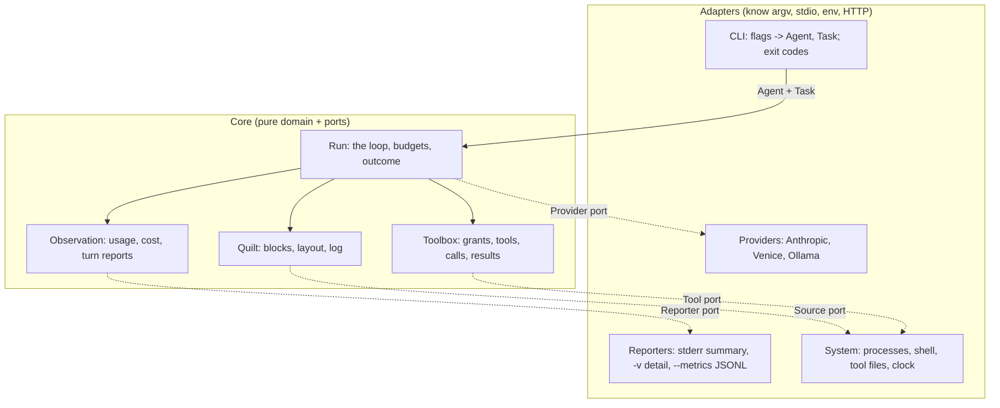
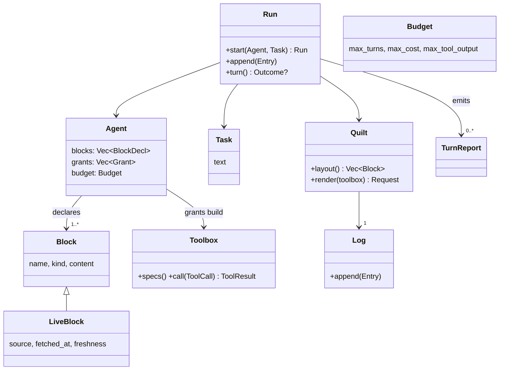
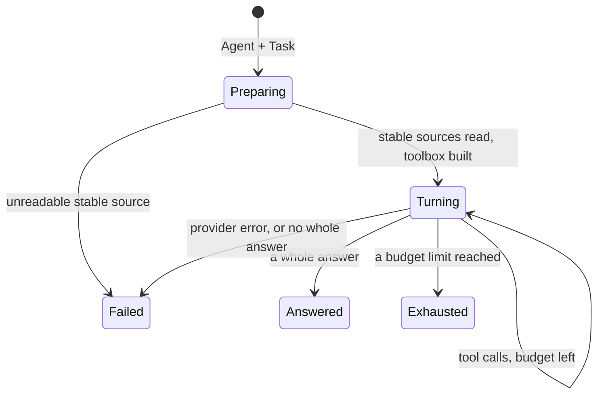
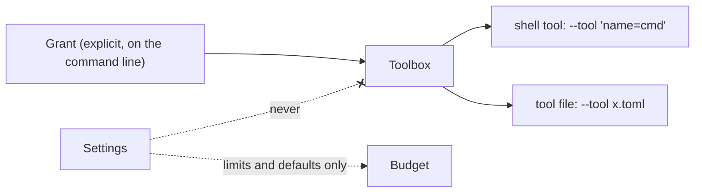

# Domain design

> The language and model of fussycat. Why and what: [`INTENT.md`](INTENT.md).
> The checks that hold the code to it: [`architecture.eval.md`](architecture.eval.md).

fussycat implements the [Agent Quilt Framework][spec] (version
`2026-10-06T03:24:00Z`). This doc **doesn't restate** it: the framework's
concepts (block, quilt, adapter, turn report), layout invariants (L1–L4),
operations and adapter rules (A1–A2) apply as written, except for the
decisions below. This doc adds what's specific to a batch CLI agent with
tools, grants and budgets. *How* lives in the code's doc comments.

## Decisions

| # | Decision | Why |
|---|---|---|
| D1 | **`stable`, not `static`**, everywhere, including the flag. | Kinds are named by *lifetime*; static/dynamic is too coarse. |
| D2 | **Deviation from L2:** declarations are *grouped* by kind, then declaration order, instead of rejected when out of kind order. | On a command line the order of flags across kinds means nothing. Grouping is still a pure function of the declarations, so caching is unaffected. |
| D3 | An **Agent** is the reusable declaration; a **Run** is one execution of it against a **Task**. | The same Agent gives the same prefix across cron runs (principle 3). |
| D4 | **Grants vs limits.** Grants come only from the Agent's explicit declaration. Settings may supply limits and defaults, never grants. | Principle 2: the command line is the permission manifest. |
| D5 | **Sources vs tools.** An author-declared source runs every time; a tool runs only when the model calls it. Only tools need grants. | The model can never trigger a `--live` command, so declaring it *is* the permission. |
| D6 | **Every run starts with the core prompt**, `(core)`, the first stable block after the tools, with no flag to drop it. It explains only what the agent has: live blocks only with a `--live`, tools only with a `--tool`. | Every agent needs the harness's conventions (the reply is the output, tool output is untrusted, turns are limited, never invent), and few authors would write them. Told about tools it doesn't have, a model invents calls to them. It's constant per declaration, so it doesn't break the cache. Measured before adoption: better answers at no cost. |

## Bounded contexts



| Context | Owns | Knows nothing about |
|---|---|---|
| **Run** | The loop: refresh, render, call, run tools, check budgets, stop. | argv, stdio, wire formats |
| **Quilt** | Blocks, kinds, layout, the log, rendering a provider-neutral request. | Which provider, how sources fetch |
| **Toolbox** | Which tools are granted, their specs, dispatching calls. | Who granted them |
| **Observation** | Usage, cost, turn reports, the run summary. | Where reports go |
| **Providers** | Wire format, cache breakpoints (A1), mapping usage back (A2). | The loop |
| **CLI** | Parsing, exit codes, printing. | Domain rules beyond validation |

Dependencies point inward: adapters depend on the core's ports, and the core
depends on nothing outside itself.

## Model



**Agent** (value object): everything the author declares. Immutable, no run
state. The model is named `PROVIDER:MODEL` (`ollama:gpt-oss:20b`), split at
the first colon; the reference lives in the adapter, because the core can't
name providers (S3).

**Task** (value object): the text on stdin, and the log's first entry. A run
without one is a usage error, not an empty conversation.

### Run (aggregate root)

One execution of an Agent against a Task. Every run starts fresh and leaves
nothing behind except what stdout and the reporters emit.



**Outcome** = `Answered(text)` | `Exhausted(limit)` | `Failed(reason)`. Only
the outcome is a type; the loop's position is the state. The CLI maps it to
stdout and an exit code; the core never prints.

**An answer** is a reply the model ended itself, with no tool calls and text
that isn't just whitespace. Anything else fails the run, after the turn is
reported (it was paid for): an empty reply, a reply cut off at the output
limit (part of an answer isn't one, so none is printed), tool calls cut off
(none run), or a provider's refusal. So `fussycat ... > report.md && publish`
never publishes half a report.

**Exit codes** draw the line between *what was typed* (a usage error, 2) and
*what the world did* (a failure, 1): a well-formed declaration that fails at
runtime, like an unreadable `--stable` file, is exit 1, as `cat /nope` is. A
limit reached is 3, and a stop signal 128 + the signal. The full table is in
[`docs/usage.md`](../docs/usage.md#exit-codes).

Cheap checks come first: a typo or an empty task never prompts for a key or
leaves a file behind. A reader that closes the pipe early (`| head -1`) keeps
the run's exit code. A stop signal kills the running command with its whole
process group and starts nothing more; stdout stays empty. SIGHUP is left
alone, so `nohup` still works.

### Turn

One model call, following the framework's `turn` operation: check the
budget, refresh every live block, render, call the provider, append the
reply to the log, run any tool calls and append their results, report. A
tool failure is a *result* the model sees, not a run failure.

The turn and the run are separate operations. `Run::start` reads the stable
sources and starts the log; `run.turn(provider, clock, reporter)` is one
turn, ending in nothing (the model called tools: go on) or an Outcome. The
ports are lent to each turn, not held by the run. `execute` is the CLI's
run: `start`, then `turn` until an Outcome, then the summary. A host that
keeps a run between events does the same with `run.append` between turns,
one turn in flight at a time (`turn` takes the run by `&mut`).

### Quilt, blocks and kinds

| Kind | Declared by | Content | Status |
|---|---|---|---|
| **stable** | `--stable FILE`, after the tools and the core prompt | Read once at the start (L4), so `<(cmd)` works | built |
| **pinned** | The agent, through pin and unpin tools | Fixed from pin to unpin | later |
| **log** | Nobody: every run has exactly one | Append-only | built |
| **live** | `--live 'CMD'` | Replaced every turn | built |

- **Layout** = kind order (L1), then declaration order (D2): a pure function
  of the Agent, computed once.
- **The tools come first**, sorted by name, as the first stable block. That's
  Anthropic's cache order, and sorting keeps the bytes the same whatever
  order the grants came in.
- **The core prompt comes next** (D6). **Otherwise fussycat adds nothing above
  the log:** no date, version or run id (principle 3).
- **A block's name** is unique in the quilt, derived from its source unless
  given. Reports refer to blocks by name.

### Sources and freshness

A source produces a block's content: a file or a command. Stable sources are
read once; live sources are re-run before every turn. A live block never
disappears and never aborts a turn:

| Freshness | Renders as |
|---|---|
| `Fresh` | the content and when it was fetched |
| `Stale` | the last good content, its age and the error |
| `Failed` | the error only: no fetch has succeeded yet |

`Failed` is fussycat's addition to the framework's stale rule: on turn 1
there's no last good content. The core renders the text, so every provider
shows a live block the same way:

```text
<live name="date -u" fetched_at="2026-10-23T21:00:54Z">
Fri Oct 23 21:00:54 UTC 2026
</live>
```

### Log

Entries are `Task` (always first), `Assistant` (thinking, text, tool calls)
and `ToolResults` (one per call, matched by id). They're provider-neutral.
What a provider needs replayed byte for byte (signed thinking, its own call
ids) rides on the `Assistant` entry as opaque **ProviderData** that only the
adapter that wrote it reads (A2).

### Grants and tools



- **Grant:** explicit permission for one tool. No grants means an empty
  toolbox and a model that can only answer.
- **Tool:** a spec (name, description, input schema) plus how to run it.
  Every tool has the same shape, so the loop never branches on its type.
- **Shell tool** (`name=cmd`): the author's command, run by a shell. It takes
  no arguments: the model can only trigger it.
- **Tool file** (TOML): a program run from an argv list, never a shell.
  Either typed inputs fill `{placeholders}` in a fixed argv (a narrow grant),
  or `{args...}` lets the model supply the arguments to one program (a broad
  grant). Arguments are checked before anything runs: a value can't start
  with `-` unless its input allows it, and a `pattern` must match the whole
  value. `env = [...]` passes named variables through (see the security
  model).
- **Calls and results:** a result is `Ok` or `Err`, and both go back to the
  model. Calling an ungranted name is an `Err` result, never an execution.

### Budget

Limits that guarantee a run ends, and keep it bounded while it runs. Hitting
one is `Exhausted` (exit 3), a normal outcome.

| Limit | Default | Bounds |
|---|---|---|
| `--max-turns` | 10 | model calls per run |
| `--max-cost` | off | US dollars of *provider-reported* cost, checked before each call. A turn with unreported cost fails the run rather than spend blind, so it's refused up front for a provider that never reports cost. |
| `--max-tool-output` | 32 KiB | each tool result and live block, cut visibly with a note giving the true size |
| `--command-timeout` | 60 s | any command fussycat runs; at the limit its whole process group is killed and it fails like any failing command |
| `--max-output-tokens` | the provider's | each reply; a reply cut off at the limit fails the run, so a low limit is never silent |

The limits are checked at the start of every turn, cost first, so the cost
limit wins when both are reached on one turn. They're checked again after
the reply and before its tool calls: if no turn will follow, the tools don't
run, because nothing would read their results and a side-effecting tool
would fire for nothing (R3). The turn report counts them as
`skipped_tool_calls`. Telling the model it's on its last turn was the
alternative; it's left out for now because the model may call tools anyway,
so they'd still have to be skipped. It could come later as a note in the
live tail.

### Observation

- **Usage:** input, output, cache-read and cache-write tokens, exactly as the
  provider reported them (principle 4). Cache counts are part of `input`, so
  the hit rate is `cache_read / input`. Unreported is `null`, never 0, and a
  total is known only if every turn reported it.
- **Cost:** as the provider reported it, in US dollars, or unknown. Never a
  guess, and never 0 because a model looks local.
- **Retries:** failed provider attempts the adapter retried, per turn and per
  run, so a flaky provider shows up as retries rather than an unexplained
  slow run. The adapter owns the mechanism; the core only counts. A call
  that fails after retrying still adds its retries, and gets a turn report
  of its own (`stop` null, usage unreported); the summary's `turns` counts
  only turns with a reply.
- **Fingerprint:** a stable hash of each block above the log, so cross-run
  cache breaks are a `jq` job over `--metrics`. Wire bytes are pinned
  separately, by each adapter's golden test.
- **Divergence:** the first seam whose fingerprint changed since the last
  turn. *Later, with pinned blocks:* until then nothing above the log can
  change within a run.
- **TurnReport** and **RunSummary:** a JSON line per turn and per run with
  `--metrics`; a summary line on stderr, `-v` for a line per turn, `-q` for
  none.

### Ports

| Port | Implemented by | For |
|---|---|---|
| `Provider` | Anthropic, Venice, Ollama | a request in; a reply, usage and retries out |
| `Source` | file (`--stable`), command (`--live`) | block content |
| `Tool` | shell tool, tool file | one granted tool: its spec and its invocation |
| `Clock` | the system clock; a fake in tests | fetch times, durations |
| `Reporter` | stderr, JSONL; a recorder in tests | turn reports, the run summary |

Tools are a port *per tool*, so a new kind of tool never touches the loop.
Every command runs through one process runner, which bounds its output and
time and kills its whole process group. The core is tested with fakes for
every port: no network, no shell. Listing models (`--list-models`) is
adapter-only: it isn't a run.

## Security model

**The rule: allow, never assume.** The caller grants what a run can do by
what it hands over, and by the same logic isolates fussycat. fussycat doesn't
sandbox; it's built to be sandboxed.

- **Who is trusted.** The author: the command line is the permission
  manifest. **The model is not hostile, but it is eager:** it acts on any text
  in its context. So treat any tool call as possibly written by whoever wrote
  the worst text in the context (a web page, a log line, an email).
- **The lethal trifecta.** A run is dangerous when its grants combine
  *private data*, *untrusted content* and *a way out* (curl, mail, git push).
  Any two are safe; all three let an injection exfiltrate. Every grant is on
  one command line, so a run can be checked by reading it.
- **Children get a clean environment.** Every tool and live command starts
  with only `PATH`, `HOME`, `USER`, `LOGNAME`, `LANG`, `LC_ALL`, `TZ` and
  `TMPDIR`. A credential reaches a child only when a tool file names it in
  `env`, for that one tool. The one exception is deliberate: the key
  command runs in the author's environment, because the author wrote it,
  it runs once before the model is called, and its output is the secret
  anyway. That's where secret stores keep their settings.
- **Keys travel only through pipes.** A paid provider's key comes from a
  command named in `FUSSYCAT_<PROVIDER>_KEY_COMMAND`, which fussycat runs and
  reads from its stdout. The key is never in argv, the environment or a
  file, and no error shows it. Any command that prints a key will do
  (examples in [`docs/usage.md`](../docs/usage.md#providers-and-keys)).

- **Handguns are allowed, and labelled.** A broad tool file is the author's
  choice; fussycat makes the breadth visible rather than policing it. Narrow
  typed inputs are the safe shape for anything with side effects.
- **Isolation is the caller's job.** fussycat writes only to stdout and
  `--metrics`, keeps no state and calls only its provider, so it runs
  unchanged under `sandbox-exec`, `bwrap` or a container, and its tools
  inherit the same limits.
- **Not defended, on purpose:** labelling tool output as untrusted. It
  doesn't stop injection, and would suggest it does.

## Glossary

| Term | Means | Avoid |
|---|---|---|
| Agent | The declaration: blocks, grants, budget, model | persona, profile |
| Task | stdin; the first log entry | prompt, query |
| Run | One execution of an Agent on a Task | session, conversation |
| Turn | One model call and its tool calls | step, iteration |
| Quilt | The ordered blocks of one run | context, window |
| Block, Kind | As the framework; kinds are stable, pinned, log, live | static, dynamic, section |
| Seam | The boundary between two blocks | breakpoint (the adapter's cache marker) |
| Source | Where a block's content comes from | fetcher |
| Core prompt | fussycat's own stable block, `(core)` (D6); not the core crate | system prompt |
| Grant | An explicit capability on the Agent | permission, allow-list |
| Budget | The limits that end a run | quota |
| Usage, Cost | Provider-reported tokens; provider-reported dollars | estimate |
| Outcome | Answered, Exhausted or Failed | result (a tool's) |

"Session" in the framework (L4) means a **run** here. `Quilt` is fine as an
internal type name; only crates, binaries and commands avoid *quilt* (S6).

## Open questions

- **Per-block tokens.** The framework wants tokens per block, but providers
  report only totals. A local tokenizer could estimate them; principle 4
  leans towards leaving them out until a layout decision needs them.
- **Shell tool arguments.** Should `name=cmd` ever take arguments, and how,
  without shell injection? For now, a tool file is the way.

[spec]: ../docs/agent-quilt-framework.md
