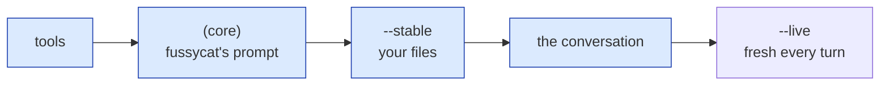

# Using fussycat

fussycat is a filter: a task goes in, an answer comes out, and everything in
between is on the command line. This page walks through the pieces you'll
reach for. The examples set the model once, so they can leave out `--model`:

```sh
export FUSSYCAT_MODEL=ollama:gpt-oss:20b
```

## A filter

Anything that prints text can be a task, and anything that reads text can
use the answer. Say you want last night's nginx errors summed up in your
inbox each morning:

```sh
journalctl -u nginx --since yesterday |
  fussycat --stable triage.md |
  mail -s "nginx overnight" me
```

The logs are the task, `triage.md` says what you care about, and the answer
goes straight into `mail`. Only the answer goes to stdout. Progress and cost
go to stderr, so nothing else ends up in the email.

### Exit codes

fussycat exits like any other tool, so `&&`, `||` and `set -e` work the way
you'd expect:

| Code | Means | For example |
|---|---|---|
| 0 | Answered | |
| 1 | Failed | an unreadable `--stable` file, an unreachable provider, a failing key command, an empty or cut-off reply |
| 2 | Usage | a bad flag, an empty task, no key command for a paid provider |
| 3 | A limit was reached | `--max-turns`, `--max-cost` |
| 130, 143 | Stopped by SIGINT or SIGTERM | Ctrl-C, `timeout 300 fussycat ...` |

An empty or cut-off reply counts as a failure, so `fussycat ... > report.md
&& publish report.md` never publishes half a report. Typos are caught before
anything runs, a reader that stops early (`| head -1`) isn't a failure, and
Ctrl-C also stops whatever command fussycat was running.

## Blocks: what the model sees

Two flags shape what the model reads. A `--stable` file is read once, at the
start: instructions, a style guide, a schema. A `--live` command is re-run
before every turn, and the model sees its fresh output *instead of* the old
one. Here's an agent that checks on your branches:

```sh
echo "Which of my branches are behind their upstream? Fetch first." |
  fussycat \
    --live 'git branch -vv' \
    --tool 'fetch=git fetch -q'
```

On its first turn the model sees the branches as they were, and asks to
fetch. Before its next turn `git branch -vv` runs again, so it sees them as
they are now, without spending a tool call to look. (`--stable` takes
process substitution too: `--stable <(git log -20)`.)

fussycat lays the context out by how long each block lives, so everything up
to the conversation is byte-identical from turn to turn, and from run to
run:



That makes a shell loop a warm loop. Here every review after the first reads
the rules from the provider's cache, so you pay full price for them once:

```sh
for f in src/*.rs; do
  fussycat --stable review-rules.md < "$f" > "reviews/${f##*/}.md"
done
```

## Tools: what the model can do

A bare run has **no tools**, so the model can only answer from what it's
been given. Grant each tool on the command line:

```sh
echo "What time is it in UTC?" | fussycat                       # it can't know, and says so
echo "What time is it in UTC?" | fussycat --tool 'now=date -u'  # now it can
```

`NAME=COMMAND` grants a command that takes no arguments: the model can run
it, but can't change it. For a tool that takes input, write a
[tool file](tools.md). Either way, tools start with a clean environment, so
your `GITHUB_TOKEN` and cloud keys stay behind unless a tool file names them.

## Limits

A run always ends, which matters when it's cron watching, not you.
`--max-turns` (default 10) caps model calls, `--max-cost USD` stops the run
once the provider-reported cost reaches USD, and `--max-output-tokens` caps
each reply. Tool output is cut, visibly, at `--max-tool-output` (32 KiB),
and `--command-timeout` (60 s) kills a tool or `--live` command that hangs.
Hitting a limit exits 3, so the script around it can tell. On the turn
that reaches `--max-turns` or `--max-cost`, the model's tool calls don't
run: no turn follows to read their results, so a tool that sends or pushes
never fires for nothing. `-v` and `--metrics` show them as skipped.

## Metrics

Every run tells you what it cost, in the provider's own numbers, never an
estimate. Here's a real run with `-v`, which adds a line per turn:

```text
fussycat: turn 1: 9.4s, 3 tool calls; tokens in 1713 (0 cached, 0%; 1654 written), out 231
fussycat: turn 2: 4.4s, 3 tool calls; tokens in 5662 (1542 cached, 27%; 4059 written), out 368
fussycat: turn 3: 9.8s, 0 tool calls; tokens in 14456 (5601 cached, 38%; 8794 written), out 2220
fussycat: answered after 3 turns in 23.7s; tokens in 21831 (7143 cached, 32%; 14507 written), out 2819
```

Watch the cached share climb as the conversation grows: what one turn
writes to the cache, the next reads back. Without `-v` you get just the last
line; `-q` turns it off. For the long view, `--metrics FILE` appends a JSON
line per turn and per run, ready for `jq`:

```sh
# The share of input tokens served from the cache, across every run so far.
jq -s 'map(select(.type == "summary").usage) | (map(.cache_read) | add) / (map(.input) | add)' runs.jsonl
```

## Providers and keys

The same agent runs on any provider: change `--model` and you're done.

| Provider | `--model` | Key |
|---|---|---|
| Ollama | `ollama:gpt-oss:20b` | none; `--ollama-url` or `FUSSYCAT_OLLAMA_URL` (default `http://localhost:11434`) |
| Anthropic | `anthropic:claude-haiku-5-5` | `FUSSYCAT_ANTHROPIC_KEY_COMMAND` |
| Venice | `venice:claude-haiku-5-5` | `FUSSYCAT_VENICE_KEY_COMMAND` |

`fussycat --list-models PROVIDER` shows what you can run.

Keys are the one thing fussycat is strict about. A key never goes in argv,
the environment or a file, where other processes, your shell history or a
backup could pick it up. Instead you name a command that prints it, and
fussycat reads it through a pipe:

| Store | Key command |
|---|---|
| pass | `pass show ITEM` |
| macOS Keychain | `security find-generic-password -s ITEM -w` |
| 1Password | `op read op://VAULT/ITEM/credential` |
| A file only you can read (`chmod 600`) | `cat ~/.config/fussycat/anthropic-key` |

```sh
export FUSSYCAT_ANTHROPIC_KEY_COMMAND='pass show anthropic'
```

Unlike tools, the key command runs with your whole environment, so a store
configured there works as it does in your shell, under cron too: a 1Password
service account (`OP_SERVICE_ACCOUNT_TOKEN`), Vault (`VAULT_ADDR`,
`VAULT_TOKEN`), or pass with its own `PASSWORD_STORE_DIR`. Set those in the
environment, never in the command itself.
